# Lootbot

Lootbot is a programming game. Teams write code that drives a robocar through a maze, and the car holding the most gifts when the timer ends wins. Nobody steers by hand: each team's program decides every move.

The whole game runs on one laptop, the **host laptop**. Teams' laptops connect to it over the local Wi-Fi. A projector shows the match to the room.

This guide walks the host through an event, from installing the game to showing the winner. The first setup takes about 15 minutes.

## Contents

1. [What you need](#1-what-you-need)
2. [Install the game](#2-install-the-game)
3. [Start the server](#3-start-the-server)
4. [Put the stage screen on the projector](#4-put-the-stage-screen-on-the-projector)
5. [Build a map](#5-build-a-map)
6. [Let teams join](#6-let-teams-join)
7. [Check every team's connection](#7-check-every-teams-connection)
8. [Start a match](#8-start-a-match)
9. [During the match](#9-during-the-match)
10. [Results and the winner](#10-results-and-the-winner)
11. [Watch a replay](#11-watch-a-replay)
12. [If something goes wrong](#12-if-something-goes-wrong)
13. [Checklist before the event](#13-checklist-before-the-event)
14. [For developers](#14-for-developers)

## 1. What you need

| Item | Why |
| --- | --- |
| Host laptop with [Node.js 20 or newer](https://nodejs.org) | Runs the game server, the admin page and the stage screen |
| A Wi-Fi router just for the game, on 5 GHz | Keeps delay low; don't use the shared venue Wi-Fi |
| A projector and speakers connected to the host laptop | The stage screen shows the maze and plays every sound |
| A few LAN cables and a small switch | Backup for teams whose Wi-Fi is slow |
| Python 3.9 or newer on each team laptop | The starter kit teams use is written in Python |

## 2. Install the game

Do this once on the host laptop, while it's online:

```bash
git clone <this repository> lootbot
cd lootbot
npm install
npm run build
```

`npm install` downloads everything the game needs, including a copy of ffmpeg that levels the teams' sound clips. `npm run build` prepares the admin page and stage screen. Run it again whenever you update the game.

## 3. Start the server

```bash
npm start
```

The terminal prints everything you need:

```text
Lootbot server running.
  Admin page:   http://localhost:8080/admin?key=628b06f25239
  Stage screen: http://localhost:8080/stage
  Agents:       ws://192.168.1.10:8080  ws://192.168.64.1:8080
  Join code:    PCWK
```

| Line | What it is |
| --- | --- |
| **Admin page** | Your control panel. Open it on the host laptop. The `key=…` part is the password. Keep it to yourself: anyone who has it can start and stop matches |
| **Stage screen** | The page for the projector |
| **Agents** | The address teams connect to. Use the one on the game router's network (it usually starts with `192.168.`) |
| **Join code** | A short code you announce at the event. Programs without it are turned away |

The key and join code change every time you start the server. To keep them the same, choose them yourself:

```bash
LOOTBOT_ADMIN_KEY=choose-a-secret LOOTBOT_JOIN_CODE=K7QM npm start
```

If port 8080 is taken, use `PORT=9000 npm start`. Leave this terminal open: closing it stops the game.

Open the **Admin page** link. The **Match** tab shows the address, a QR code for it, and the join code, ready to put on screen or read out:

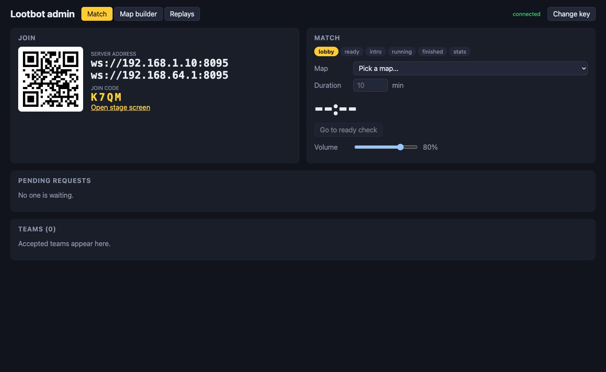

## 4. Put the stage screen on the projector

Open the **Stage screen** link (or click **Open stage screen** on the admin page) in a browser window on the projector. Make it full screen: F11 on Windows, Ctrl+Cmd+F on a Mac.

Browsers keep a page silent until someone clicks on it, so press **Enable sound** once. If the stage page is reloaded, press it again.

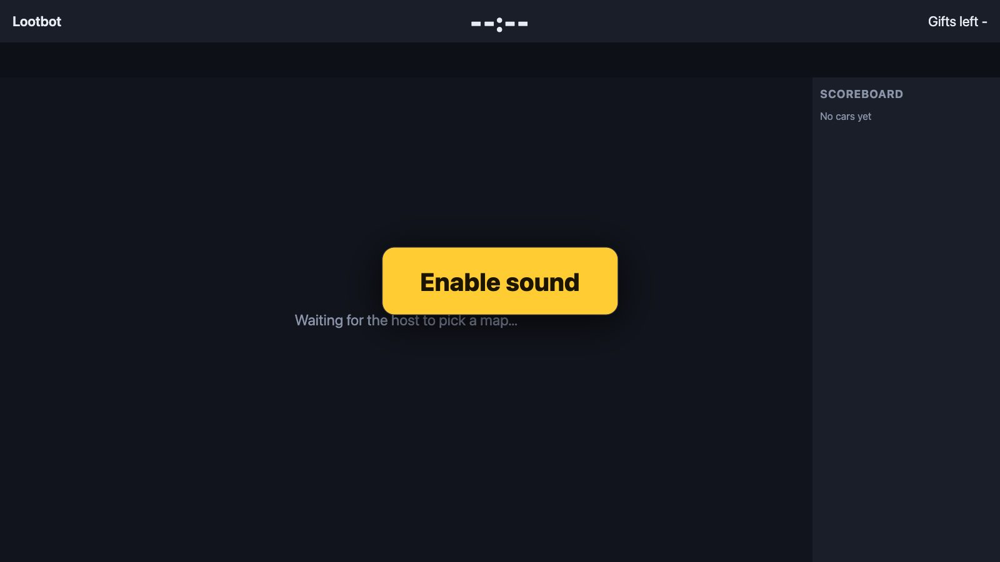

## 5. Build a map

You build maps in the admin page's **Map builder** tab. They are saved in the `maps/` folder. You need at least one map before you can run a match.

1. Click **+ New map** and type a size, for example `36x24` (width × height, in cells).
2. Pick a brush (**Wall**, **Gift**, **Ammo**, **Energy drink** or **Spawn point**) and click or drag on the grid to paint. **Floor** erases, and so does right-clicking. The outer border is always wall.
3. Type the map's name in the box above the grid.

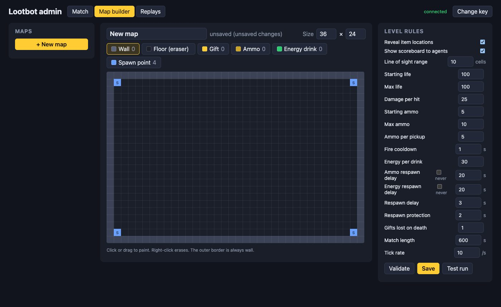

4. Set the **Level rules** on the right. Every number in the game rules can be changed per map, and the ones you change turn yellow. These change the game the most:

| Rule | Effect |
| --- | --- |
| Reveal item locations | When on, programs are told where every gift is. Turn it **off** for a harder map, so cars have to find gifts by looking |
| Show scoreboard to agents | When off, programs can't see how other teams are doing |
| Line of sight range | How far a car can see straight ahead. Shorter is harder |
| Match length | The default length. You can still change it before each match |

5. Click **Validate**. It checks that there's a spawn point for every team, at least one gift, and that every gift and spawn point can be reached. Fix anything it lists.
6. Click **Save**.
7. Click **Test run** to watch four built-in practice bots play the map for a minute on the stage screen. To stop early, click **Abort** on the Match tab.

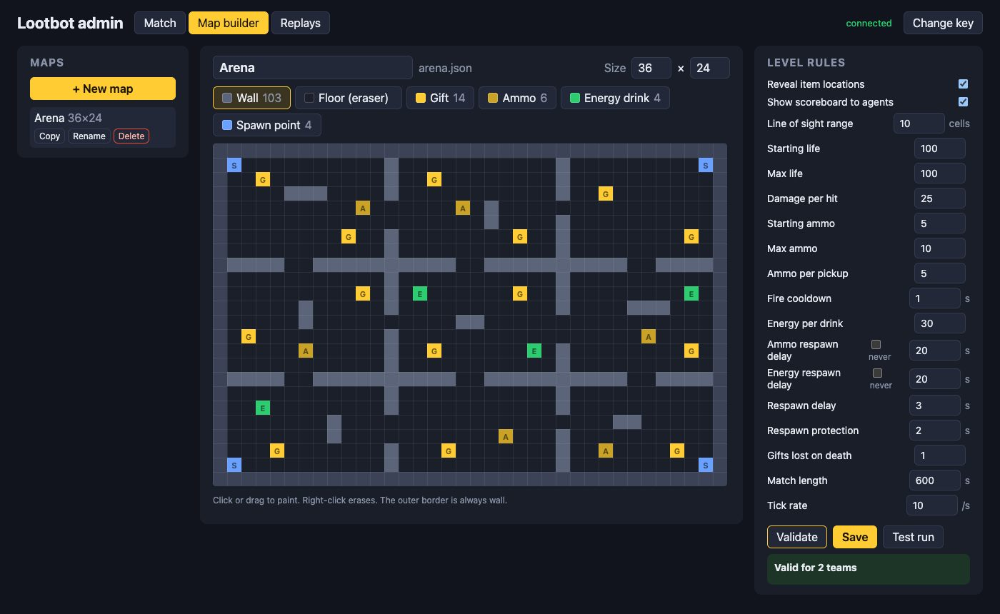

The list on the left lets you **Copy**, **Rename** or **Delete** saved maps.

**Tip:** on a small map that reveals gift locations, a match can be over in seconds, because good programs drive straight to every gift. For a real contest, use a bigger map with rooms, turn **Reveal item locations** off, and add plenty of gifts.

## 6. Let teams join

Teams need two things from you:

- **The starter kit**, in `kits/python/`. Its [README](kits/python/README.md) explains how to install it and write a car program. Send it to teams a few days before the event.
- **The server address and join code**, from the **Join** card on the admin page.

When a team starts its program, the team appears under **Pending requests** with its icon, photos and sound clips. Check them (click **Play** to hear a clip), then click **Accept**, or click **Decline** and give a reason.

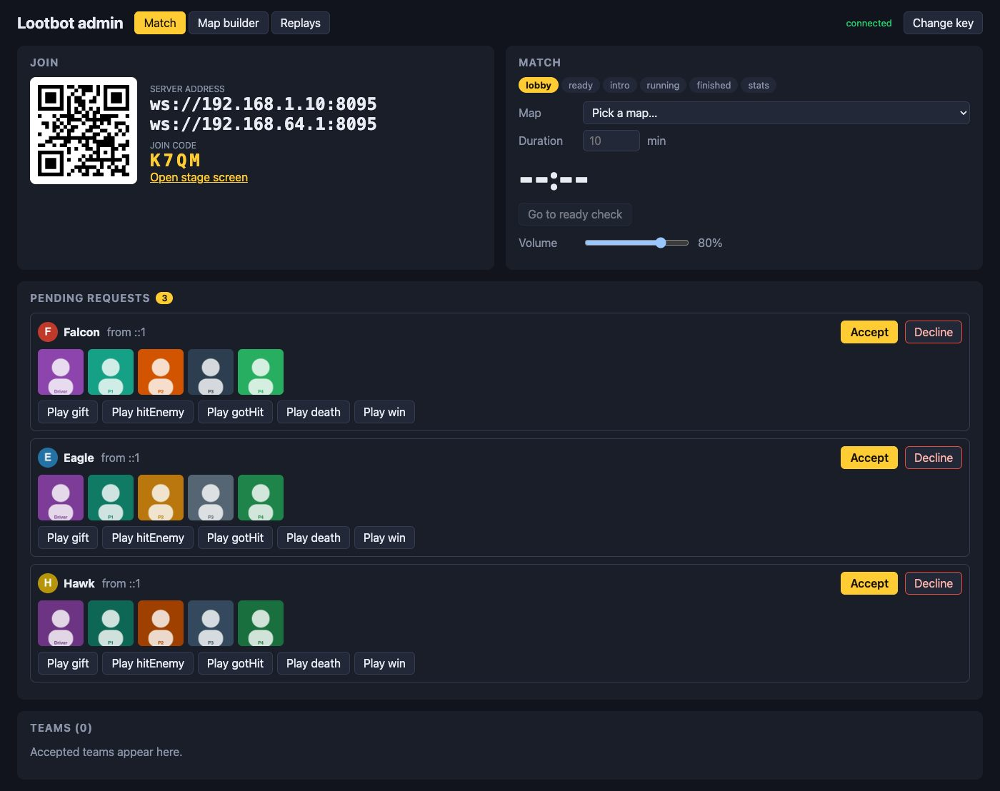

Team names must be unique. If a team loses its connection, it keeps its car: when its program reconnects, it takes control again without needing approval.

## 7. Check every team's connection

As soon as you accept a team, the game runs a 10-second **connection test** on it. The test measures the delay and checks that the team's program can turn, move, fire and collect, in a hidden practice room. The dot next to each team shows the result:

| Dot | Meaning | What to do |
| --- | --- | --- |
| Green | Ready | Nothing |
| Amber | Works, but the delay is over 100 ms | Move the laptop closer to the router or plug in a LAN cable, then click **Rerun test** |
| Red | Failed | Read the details next to the dot, ask the team to fix their program, then click **Rerun test** |
| Blinking blue | Test running | Wait about 10 seconds |

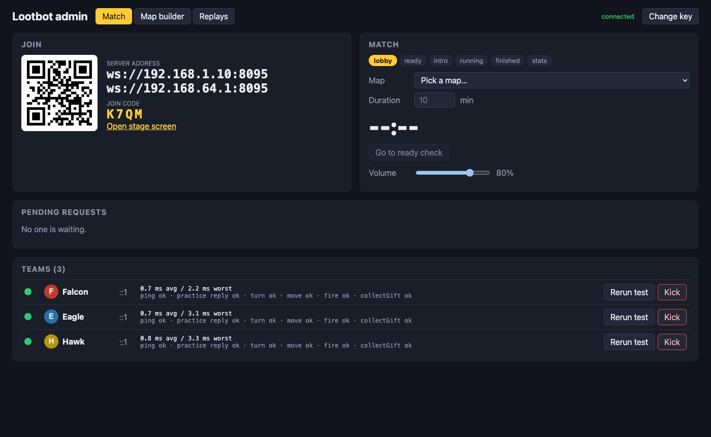

**Kick** removes a team at any time, even in the middle of a match. Its car leaves the map and its gifts go back to where they started.

## 8. Start a match

On the **Match** tab:

1. Choose the **Map**.
2. Set the **Duration** in minutes, then click anywhere else to apply it.
3. Click **Go to ready check**. The stage screen now shows the map.
4. When every team's dot is green or amber, click **Start**. **Start (override)** starts even if some teams failed the test; their cars just stand still until their programs work.

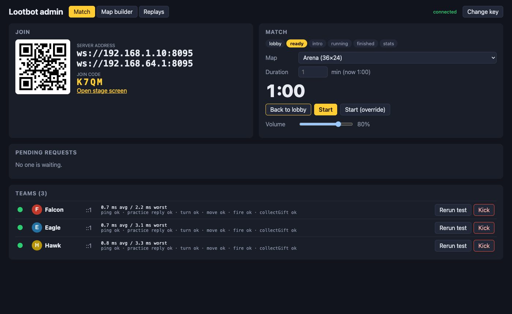

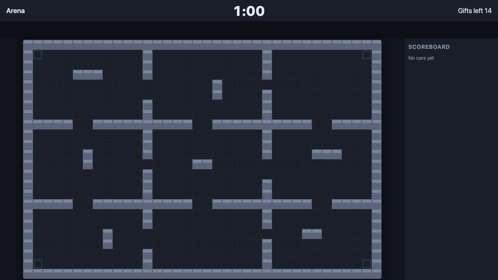

## 9. During the match

The stage screen first introduces each team for a few seconds with its name, icon, driver photo and passenger photos. Then it counts down 3-2-1 and the match starts. **Skip intro** on the admin page jumps straight to the countdown.

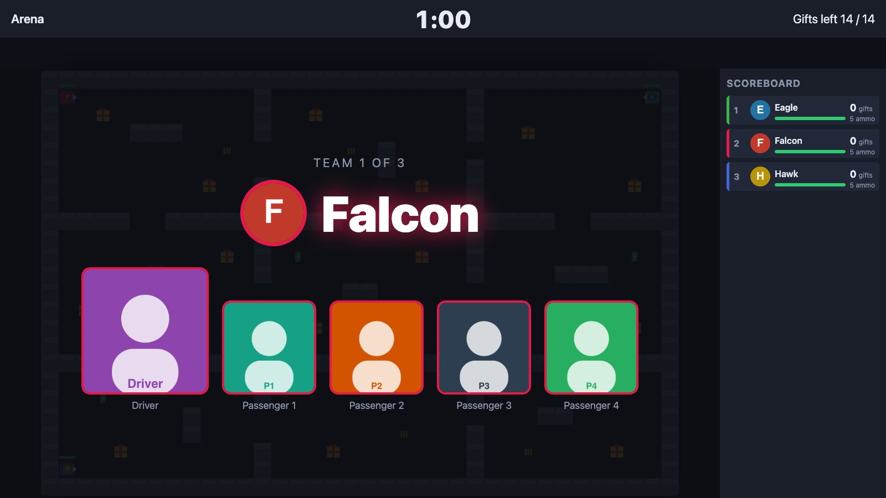

While the match runs, the stage screen shows:

- **The maze:** cars in team colours with life bars, plus gifts, ammo and energy drinks. Shots appear as tracers: red for a hit, yellow for a miss.
- **The timer** at the top, and how many gifts are left on the map.
- **The scoreboard** on the right: gifts, life and ammo for each team.
- **Now playing:** whose sound clip is playing and what happened ("Falcon collected a gift"), with a glowing ring around that team's car. Clips play one at a time, most important first, and come from the left or right speaker depending on where the car is.

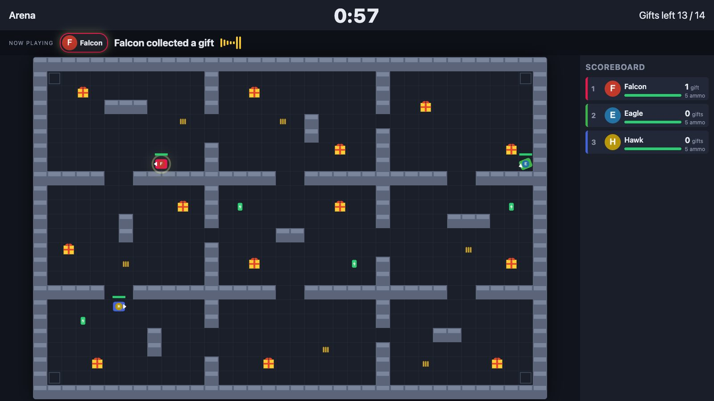

On the admin page you can use:

| Control | What it does |
| --- | --- |
| **Pause** / **Resume** | Freezes the timer, the cars and the sound |
| **Abort** | Stops the match with no result and returns to the lobby |
| **Volume** | One master volume for the room |

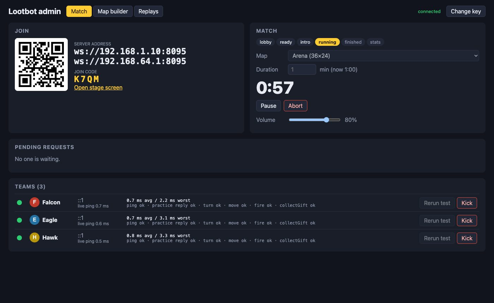

The match ends when the timer reaches zero or when no gifts are left on the map.

## 10. Results and the winner

The stage screen shows the results table, ranked by gifts. Ties go to the team with fewer deaths, then more hits landed, then more life left.

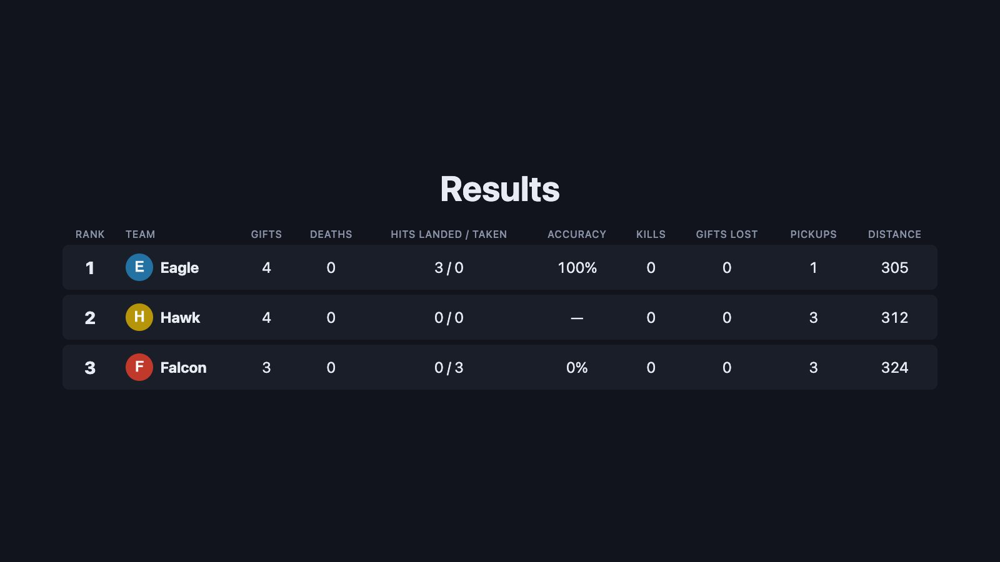

After 12 seconds, or when you click **Show winner**, the winner screen appears with the winning team's photos, and their win clip plays.

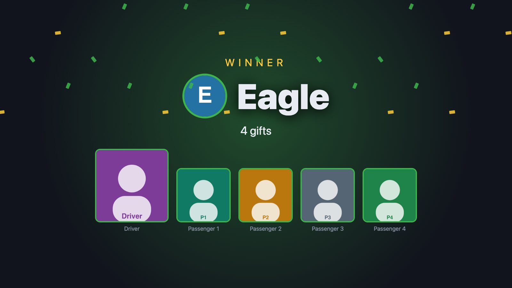

On the admin page:

- **Download stats CSV** saves the results table as a spreadsheet file.
- **New match** goes back to the lobby. Accepted teams stay accepted, so you can pick another map and start again straight away.

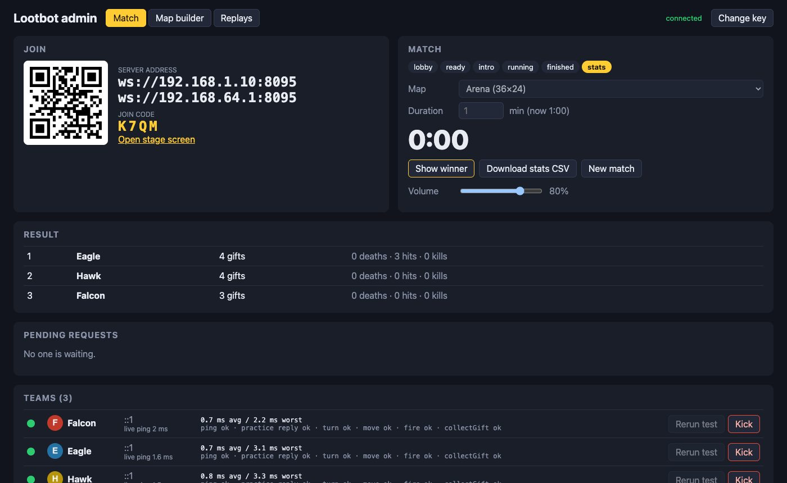

## 11. Watch a replay

Every match is saved in the `matches/` folder as it runs, and the **Replays** tab lists them. Click **Replay** to load one onto the stage screen, then click **Play**. You can pause, switch between normal and double speed (**1×** / **2×**), and drag the timeline to jump to any moment. Sounds and Now playing banners replay too. **Stop replay** gives the stage screen back to the live game.

Replays only play between matches. **CSV** downloads any match's results.

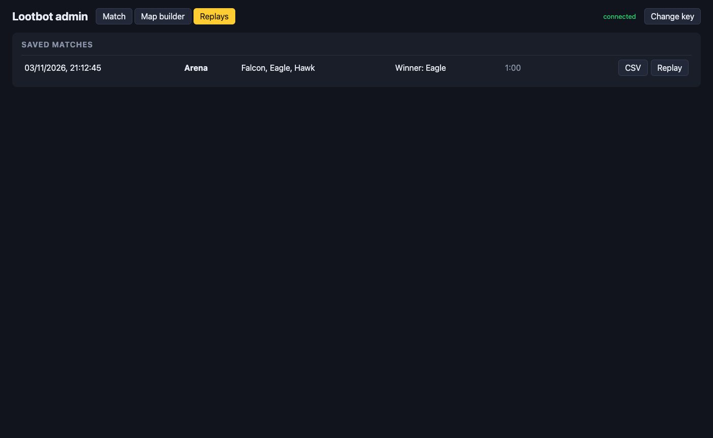

## 12. If something goes wrong

| Problem | What to do |
| --- | --- |
| A team's laptop dies or its Wi-Fi fails | Copy their program to the host laptop and, in a second terminal, run `npm run host-agent -- path/to/their_bot.py "Team Name"`. It takes over the team's existing car and runs their code unchanged |
| A team's program crashes mid-match | Its car stands still. When they restart the program, it takes the car back automatically |
| A team is amber or red | See [step 7](#7-check-every-teams-connection) |
| No sound from the projector | Click **Enable sound** on the stage screen, then check the **Volume** slider and the laptop's own volume |
| The admin page says "disconnected" | Check the server terminal is still running. If the server was restarted, the key changed: click **Change key** and paste the new one |
| "Address already in use" when starting | Another program is using port 8080. Start with `PORT=9000 npm start` |
| Teams can't connect at all | Check they're using the address on the game router's network and the right join code, and that the laptop's firewall allows incoming connections on the game's port |

## 13. Checklist before the event

- [ ] Router set up on 5 GHz, host laptop on a fixed IP address, firewall allows the game's port
- [ ] At least 4 laptops join, pass the connection test and play a full match
- [ ] Delay checked with every laptop connected at once
- [ ] A laptop unplugged mid-match reconnects and takes its car back
- [ ] Projector and speakers tested, Enable sound pressed, left/right sound checked
- [ ] A busy fight tested, so you've heard several clips queue up
- [ ] Every map validated and test-run
- [ ] A full match replayed from the Replays tab
- [ ] `npm run host-agent` tested with one team's program
- [ ] Starter kit, server address and join code instructions sent to teams in advance

## 14. For developers

```bash
npm run dev -w server      # server with reload (port 8080)
npm run dev -w web         # admin page and stage screen with reload on :5173
npm run demo               # test run with built-in bots on the first saved map
npm test                   # server and shared tests
npm run typecheck
npx tsx server/src/game/sim.ts maps/<map>.json 4 60   # simulate a match in the terminal

cd kits/python && python -m venv .venv && .venv/bin/pip install -e ".[test]" && .venv/bin/pytest
```

| Folder | Contents |
| --- | --- |
| `shared/` | Message types and rule defaults used by the server and the web pages |
| `server/` | Game rules, tick loop, lobby, connection test, audio queue, match logs, replays |
| `web/` | Admin page and stage screen (React) |
| `kits/python/` | Starter kit and sample bot for teams |
| `maps/` | Saved maps |
| `matches/` | Saved match logs |
| `uploads/` | Team photos and sound clips |

Sound clips are trimmed and levelled with the ffmpeg copy installed by `ffmpeg-static`. Set `FFMPEG_PATH` to use a different ffmpeg.
